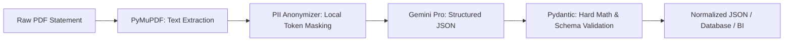

# Broker Statement IDP (Intelligent Document Processing)

A **Privacy-First Intelligent Document Processing (IDP)** microservice built with FastAPI, designed to automatically extract, mask, and validate transaction data from unstructured broker statements (e.g., XTB, Interactive Brokers).

---

## 🎯 Key Features

- **Privacy-First (Local PII Masking):** Personally Identifiable Information (name, address, tax ID/PESEL, bank account numbers, broker account logins) is masked locally before any payload is sent to cloud LLMs.
- **Resilient to Layout Variations (LLM-Powered):** Converts complex, multi-page financial statements into structured JSON using Google Gemini Pro with native Structured Outputs (JSON Schema), avoiding brittle regex table parsers.
- **Strict Mathematical Validation:** Ensures numerical consistency using Pydantic and `Decimal` arithmetic (e.g., $\text{volume} \times \text{unit\_price} \pm \text{fees} = \text{total\_value}$).
- **Data Pipeline Ready:** Clear REST API contract optimized for orchestration in Apache Airflow, storage in PostgreSQL, and analytics in Apache Superset.

---

## 🏗️ Processing Pipeline



---

## 📁 Repository Structure

```text
broker-statement-idp/
├── app/
│   ├── core/
│   │   ├── __init__.py
│   │   └── config.py              # Pydantic-settings configuration (.env loader)
│   ├── services/
│   │   ├── __init__.py
│   │   ├── pdf_parser.py          # PyMuPDF-based text ingestion service
│   │   └── pii_anonymizer.py      # Privacy-First regex PII masking engine
│   └── __init__.py
├── samples/
│   ├── generate_xtb_sample.py    # Generates synthetic bilingual XTB statement PDF
│   ├── inspect_raw_text.py       # Extracts raw text and layout blocks using PyMuPDF
│   └── xtb_statement_sample.pdf  # Generated reference sample statement
├── tests/
│   ├── __init__.py
│   ├── test_pdf_parser.py        # Unit tests for PDF extraction & byte handling
│   └── test_pii_anonymizer.py    # Unit tests for PII masking & financial data preservation
├── .env.example                  # Environment configuration template
├── .gitignore                    # Strict Git ignore rules for PII and secrets
├── requirements.txt              # Production and development dependencies
└── README.md                     # Project documentation
```

---

## 🚀 Quickstart

### 1. Prerequisites
- Python 3.11+
- Google Gemini API Key (`GEMINI_API_KEY`)

### 2. Environment Setup

```bash
# Create virtual environment
python3 -m venv .venv
source .venv/bin/activate  # macOS / Linux
# or: .venv\Scripts\activate on Windows

# Install dependencies
pip install -r requirements.txt

# Configure environment variables
cp .env.example .env
# Add your GEMINI_API_KEY inside .env
```

### 3. Running Automated Tests

```bash
# Run test suite with pytest
pytest -v

# Run code style & linting checks
ruff check .
```

---

## 🧪 Testing & Samples

### Generate a Synthetic XTB Statement
To create an authentic, bilingual (PL/EN) synthetic broker statement with mock PII and realistic stock transactions:

```bash
python samples/generate_xtb_sample.py
```

### Inspect Raw Text Extracted by PyMuPDF
To verify the raw text blocks and layout parsed by the PDF engine:

```bash
python samples/inspect_raw_text.py
# Or inspect an external file:
# python samples/inspect_raw_text.py path/to/statement.pdf
```

---

## 🛡️ Privacy & Security

This system is built from the ground up to respect financial data privacy:
- The `.env` file containing secrets is strictly excluded from version control via `.gitignore`.
- Raw user statements (PDFs) are never committed to the repository.
- Local regex-based PII masking prevents sensitive identity details (names, addresses, PESEL/tax IDs, account IDs, and bank IBANs) from leaving the host machine.
