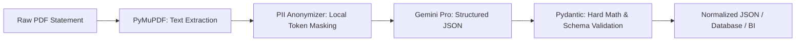

# Broker Statement IDP (Intelligent Document Processing)

A **Privacy-First Intelligent Document Processing (IDP)** microservice built with FastAPI, designed to automatically extract, mask, and validate transaction data from unstructured broker statements (e.g., XTB, Interactive Brokers).

---

## 🎯 Key Features

- **Privacy-First (Local PII Masking):** Personally Identifiable Information (name, address, tax ID/PESEL, account numbers) is masked locally before any payload is sent to cloud LLMs.
- **Resilient to Layout Variations (LLM-Powered):** Converts complex, multi-page financial statements into structured JSON using Google Gemini Pro with native Structured Outputs (JSON Schema), avoiding brittle regex table parsers.
- **Strict Mathematical Validation:** Ensures numerical consistency using Pydantic and `Decimal` arithmetic (e.g., $\text{volume} \times \text{unit\_price} \pm \text{fees} = \text{total\_value}$).
- **Data Pipeline Ready:** Clear REST API contract optimized for orchestration in Apache Airflow, storage in PostgreSQL, and analytics in Apache Superset.

---

## 🏗️ Processing Pipeline



---

## 🚀 Quickstart

### 1. Prerequisites
- Python 3.11+
- Google Gemini API Key (`GEMINI_API_KEY`)

### 2. Environment Setup

```bash
# Create virtual environment
python3 -m venv .venv
source .venv/bin/activate  # macOS / Linux
# or: .venv\Scripts\activate on Windows

# Install dependencies
pip install -r requirements.txt

# Configure environment variables
cp .env.example .env
# Add your GEMINI_API_KEY inside .env
```

### 3. Running the Development Server

```bash
uvicorn app.main:app --reload --port 8000
```

Interactive OpenAPI documentation will be available at: `http://localhost:8000/docs`.

---

## 🛡️ Privacy & Security

This system is built from the ground up to respect financial data privacy:
- The `.env` file containing secrets is strictly excluded from version control via `.gitignore`.
- Raw user statements (PDFs) are never committed to the repository.
- Local regex-based PII masking prevents sensitive identity details from leaving the host machine.
